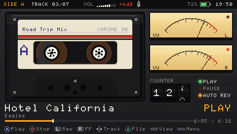
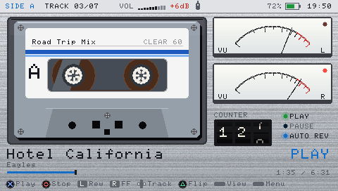
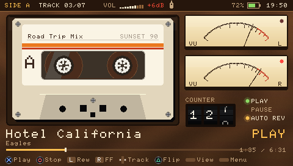
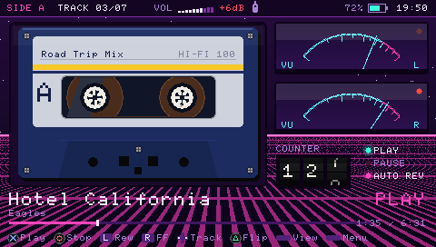
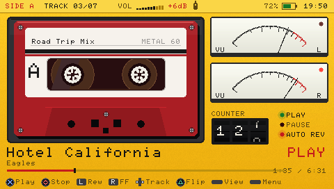
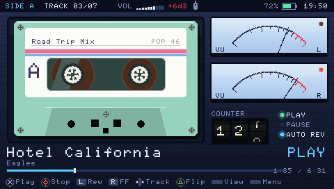
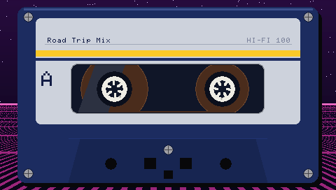

# Cassette Deck for PSP

A retro tape-deck music player for the PSP (custom firmware). Every folder of music becomes a cassette, split into Side A and Side B. The reels spin and change size as the tape plays, the tape counter rolls, and two analog VU meters bounce with the music.

> Vibe coded: the whole app was built by describing it to Claude (Anthropic's AI) in plain English and testing it on my PSP-3000. I didn't write the C code by hand.



| Themes | | |
|---|---|---|
|  |  |  |
|  |  |  |

## Features
- MP3 (any bitrate, CBR/VBR, mono/stereo) and WAV playback, decoded with libmpg123
- Tape rack: each folder in `ms0:/MUSIC` is a cassette; `label.txt` names it
- Side A / Side B, flip animation, auto reverse
- Fast forward / rewind with motor sound, speeding up the longer you hold
- Animated reels, rolling tape counter, analog VU meters with needle physics
- 6 themes: Black Deck, Silver Hi-Fi, Walnut, Neon 80s, Sport Yellow, Midnight Blue
- Views: full deck, cassette only, screen off (Walkman mode)
- Official PSP earphone remote: play/pause, tap to skip, hold to wind
- Volume boost up to +12 dB with a soft limiter (no crackle)
- Sleep timer, resume where you left off

## Install
1. Copy `release/PSP/GAME/CASSETTE` to `ms0:/PSP/GAME/` on the Memory Stick.
2. Put music in folders: `ms0:/MUSIC/Road Trip/01 song.mp3`
3. Launch **Cassette Deck** from the Game menu.

## Controls
| Button | Action |
|---|---|
| X | Play / pause |
| O | Stop (press again to eject) |
| L / R (hold) | Rewind / fast forward |
| Left / Right | Previous / next track |
| Up / Down | Volume |
| Triangle | Flip tape |
| Square | Sleep timer |
| SELECT | View: full deck → cassette only → screen off |
| START | Options: theme, volume boost, auto reverse, sleep, view |

## Build
Needs the [pspdev](https://github.com/pspdev/pspdev) toolchain.
```sh
export PSPDEV=/path/to/pspdev PATH=$PSPDEV/bin:$PATH
make
```
`tools/preview2.c` renders the screens on a PC. `tools/mock/` runs the real audio engine against a fake PSP audio device to check playback is bit-exact.
